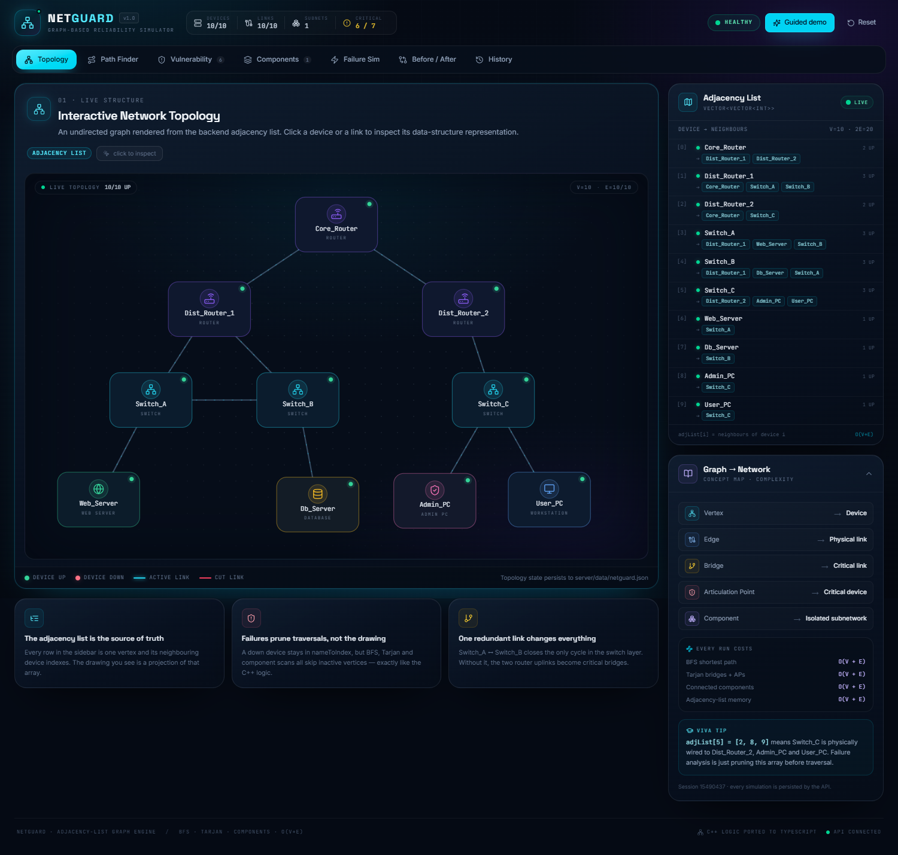
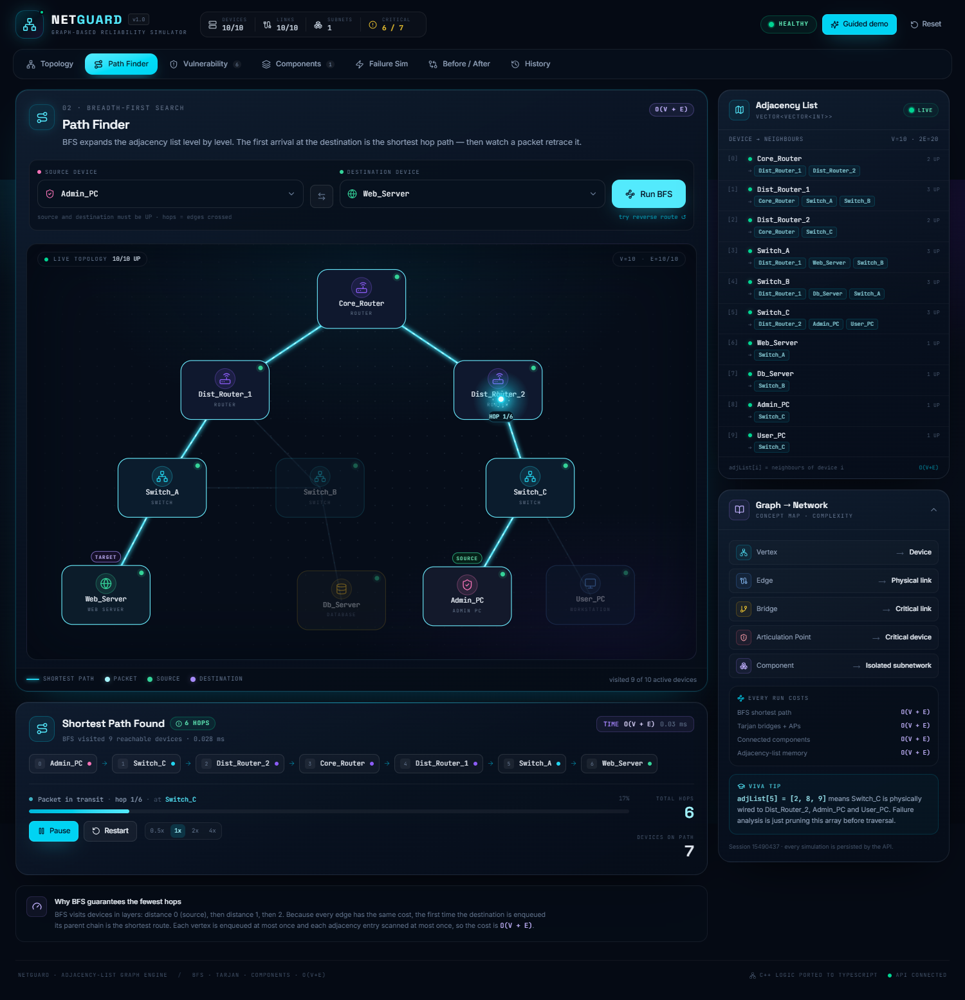
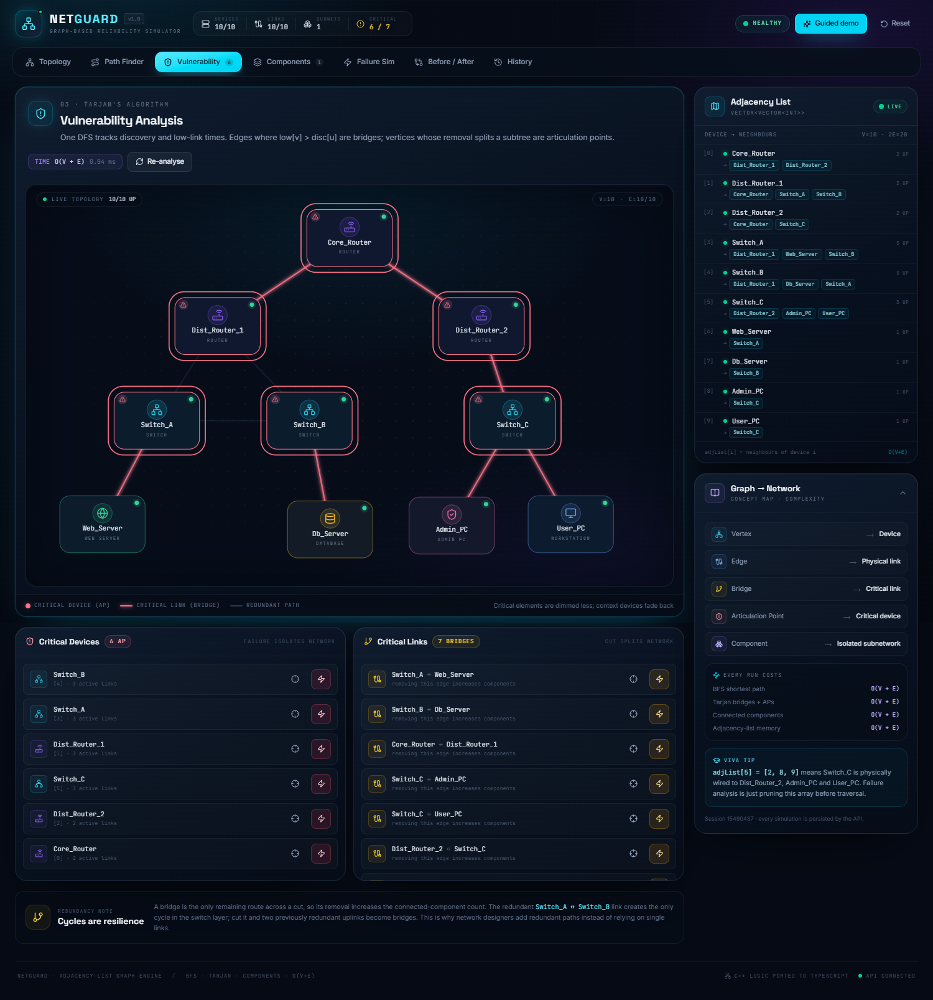
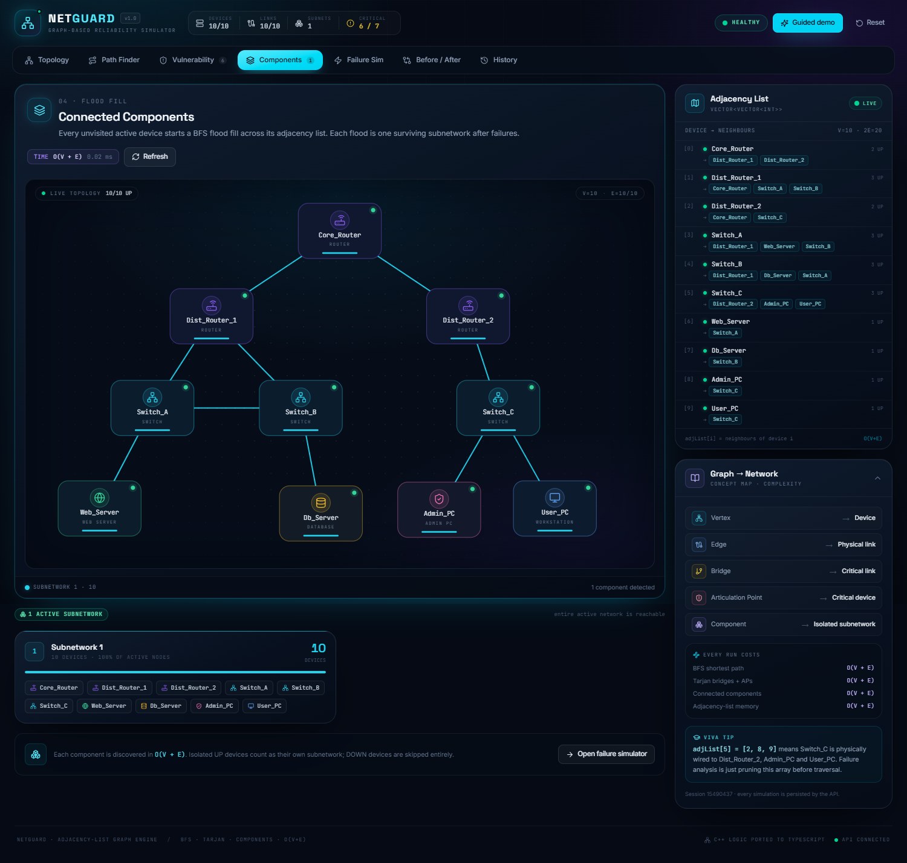
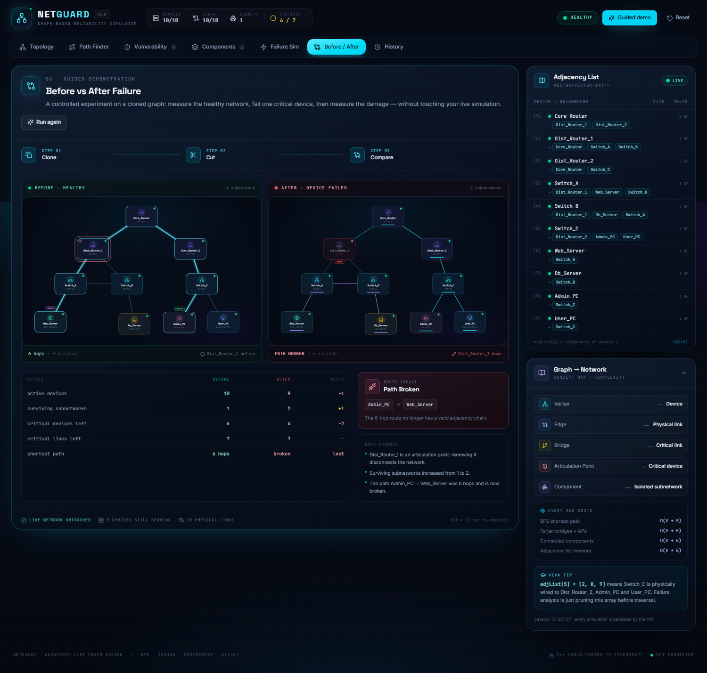
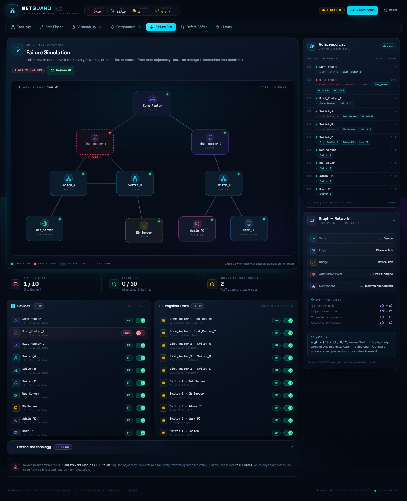
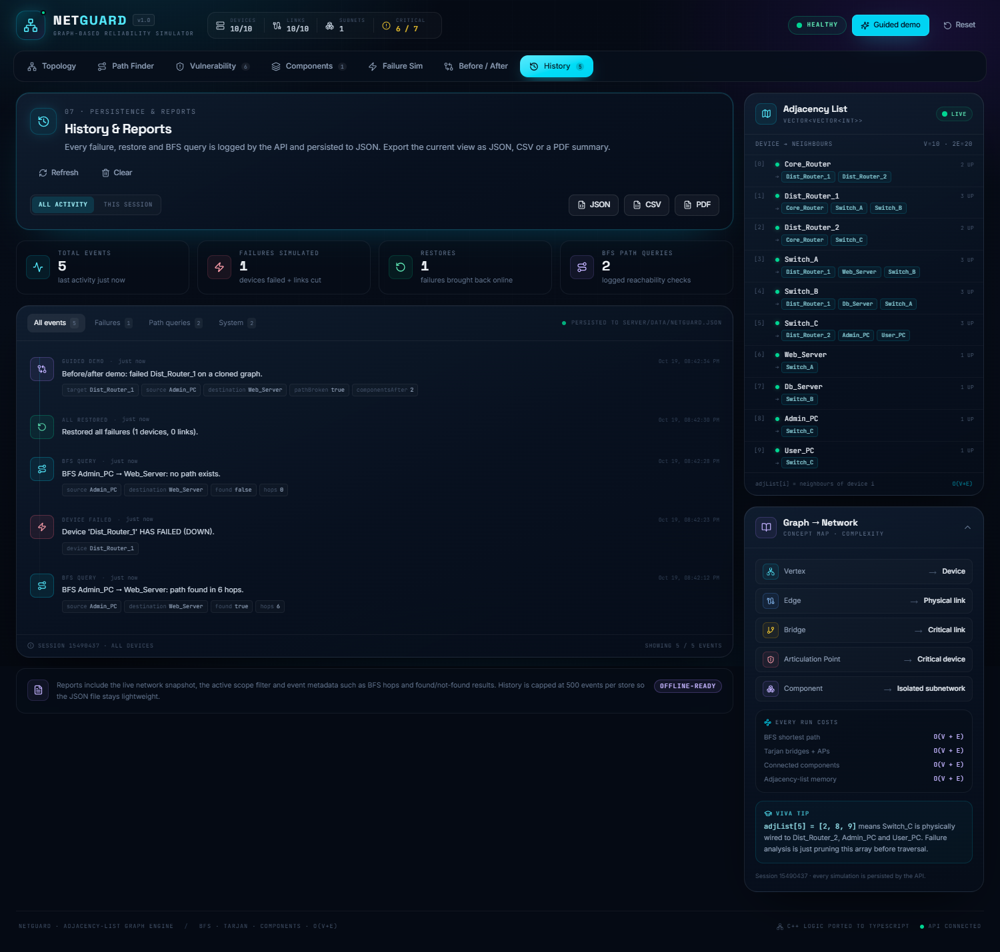

# NetGuard — Graph-Based Network Reliability Simulator

A full-stack, interactive teaching tool that turns the original **C++ `NetworkGraph`** console program into a visual network reliability lab. The core data structure is still an **adjacency list**; the UI is a live projection of that structure, backed by a TypeScript port of the same algorithms.



## Highlights

- **Interactive SVG topology** with router/switch/server/PC glyphs, status LEDs, animated link traffic, and a live adjacency-list panel.
- **Animated BFS packet** that moves hop by hop, with play/pause/restart and 0.5×–4× speed controls, plus a dedicated "Signal lost" state when no path exists.
- **Tarjan vulnerability analysis** that highlights articulation points and bridges with critical-element halos.
- **Connected-component coloring** after failures, with one card per surviving subnetwork.
- **Failure simulator** for every device and link, plus optional topology extension (add vertices and edges).
- **Guided before/after demo** that deep-clones the graph, fails a critical device, then compares path, subnetworks, and critical-element counts side by side — without touching the live network.
- **Persistent history** of every failure, restore, and BFS query, exportable as **JSON**, **CSV**, or a **PDF** summary.
- **Educational sidebar** that maps every graph concept to its network meaning and shows the `O(V + E)` cost of each algorithm.
- Fully responsive dark "network operations" theme, with keyboard-accessible devices/links and reduced-motion support.

### More screenshots

| BFS packet animation | Tarjan vulnerability analysis |
| --- | --- |
|  |  |

| Connected components | Before / after demo |
| --- | --- |
|  |  |

| Failure simulation | Persistent history |
| --- | --- |
|  |  |

## Quick start

Requirements: **Node.js 18+** and npm.

```bash
# 1. Install both workspaces
npm install

# 2. Run the API (:4000) and Vite client (:5173) together
npm run dev
```

Open **http://localhost:5173**.

The client proxies `/api` to `http://127.0.0.1:4000`. The API stores its state in `server/data/netguard.json`, which is created and seeded automatically on first run.

### Production

```bash
npm run build      # compiles the Express API and bundles the Vite client
npm start          # serves API + built client from http://localhost:4000
```

### Environment

Copy `server/.env.example` to `server/.env` if you need a different API port:

```bash
cp server/.env.example server/.env
```

```dotenv
PORT=4000
```

`PORT=0` is intentionally ignored because the Vite proxy needs a predictable port. If you change the API port, also update the `/api` proxy target in [client/vite.config.ts](client/vite.config.ts).

## Sample topology

This is exactly the 10-device topology seeded by `buildSampleTopology()` in [Mini_project.cpp](Mini_project.cpp):

- **Core:** `Core_Router`
- **Distribution:** `Dist_Router_1`, `Dist_Router_2`
- **Access:** `Switch_A`, `Switch_B`, `Switch_C`
- **Endpoints:** `Web_Server`, `Db_Server`, `Admin_PC`, `User_PC`

Links: Core↔R1, Core↔R2, R1↔SwA, R1↔SwB, R2↔SwC, SwA↔Web, SwB↔Db, SwC↔Admin, SwC↔User, and the redundant **SwA↔SwB** link.

On the healthy graph:

- BFS from `Admin_PC` to `Web_Server` finds **6 hops**.
- Tarjan finds **6 articulation points** and **7 bridges**.
- There is **1 connected component**.
- Failing `Dist_Router_1` splits the network into **2 subnetworks** and breaks the Admin → Web route.

## Graph model (the important part)

The backend class in [server/src/graph.ts](server/src/graph.ts) is a direct port of the C++ class:

| C++ | TypeScript | Purpose |
| --- | --- | --- |
| `unordered_map<string,int> nameToIndex` | `Map<string, number>` | device name → vertex index |
| `vector<string> indexToName` | `string[]` | vertex index → device name |
| `vector<vector<int>> adjList` | `number[][]` | **the adjacency list** (core structure) |
| `vector<bool> activeVertices` | `boolean[]` | up/down flag per device |
| `vector<pair<int,int>> failedLinks` | link catalog with `active` flags | remembers cut links for restore/display |

**Vertex → device. Edge → physical link. Adjacency list → who can reach whom in one hop.**

For example, `adjList[5] = [2, 8, 9]` means Switch_C is physically wired to Dist_Router_2, Admin_PC, and User_PC. The visual graph is generated from those same names and links; it is never the source of truth.

### Failure semantics

- **Device failure** mirrors `activeVertices[idx] = false`. The adjacency list is retained, but BFS, Tarjan, and component scans skip the inactive vertex.
- **Link failure** mirrors `failLink()`: the edge is physically erased from **both** adjacency lists, and the link catalog keeps it for later restoration.
- **Restore** re-adds the device flag or the two adjacency entries.
- **Add device/link** appends new vertices and bidirectional edges; duplicate names, self-loops, and duplicate links are rejected.
- Everything is persisted atomically (`tmp` + rename) to `server/data/netguard.json`.

## Algorithms

### 1. BFS shortest path — `O(V + E)`

`findPath(source, destination)` uses a queue, a `visited[]` array, and a `parent[]` array. It explores the adjacency list level by level and stops when the destination is dequeued. The path is reconstructed by walking parent pointers backwards, so the first route found is guaranteed to use the fewest hops.

Inactive devices and their links are skipped. If the source/destination is down or the destination is never discovered, the result contains `found: false` and the devices that were reachable.

### 2. Connected components — `O(V + E)`

`connectedComponents()` loops over all active vertices. Every unvisited vertex starts a BFS flood fill. Each flood is one surviving subnetwork/island. Inactive devices are excluded and listed separately in the UI.

### 3. Tarjan bridges + articulation points — `O(V + E)`

`vulnerabilityAnalysis()` performs one DFS, maintaining `disc[]` (discovery time) and `low[]` (lowest reachable discovery time).

- **Bridge:** `low[v] > disc[u]` — removing edge `u–v` splits the graph.
- **Articulation point (non-root):** a DFS child `v` with `low[v] >= disc[u]`.
- **Articulation point (root):** more than one DFS child.

The UI's red pulsing halos and "critical device/link" lists come directly from this analysis.

### Complexity summary

| Operation | Time | Extra space |
| --- | --- | --- |
| BFS shortest path | `O(V + E)` | `O(V)` |
| Connected components | `O(V + E)` | `O(V)` |
| Tarjan bridges + APs | `O(V + E)` | `O(V)` |
| Adjacency-list memory | — | `O(V + E)` |

## REST API

All mutating endpoints persist immediately. The JSON-file store survives restarts.

| Method | Endpoint | Description |
| --- | --- | --- |
| `GET` | `/api/health` | service readiness |
| `GET` | `/api/graph` | devices, links, adjacency list, metrics |
| `POST` | `/api/devices` | add a device `{ name }` |
| `POST` | `/api/links` | add a link `{ u, v }` |
| `POST` | `/api/devices/:name/fail` | mark device DOWN |
| `POST` | `/api/devices/:name/restore` | mark device UP |
| `POST` | `/api/links/fail` | cut link `{ u, v }` |
| `POST` | `/api/links/restore` | restore link `{ u, v }` |
| `POST` | `/api/restore-all` | restore every failed device/link |
| `POST` | `/api/reset` | reset to the healthy 10-device sample |
| `POST` | `/api/path` | BFS `{ source, destination }` |
| `GET` | `/api/components` | connected components |
| `GET` | `/api/vulnerabilities` | articulation points + bridges |
| `GET` | `/api/demo/before-after` | cloned before/after experiment |
| `GET` | `/api/history` | persisted event log (optionally `scope=session`) |
| `DELETE` | `/api/history` | clear the event log |

The browser creates a session UUID in `localStorage` and sends it as `x-session-id`; history can be viewed across all devices or for the current browser session. No authentication is required for this local educational project.

## Project structure

```text
netguard/
├── client/
│   ├── src/
│   │   ├── components/        # canvas, sidebar, header, tabs, UI kit, error boundary
│   │   ├── tabs/              # Topology, Path, Vulnerability, Components, Failure, Demo, History
│   │   ├── store/             # Zustand API + UI state
│   │   ├── lib/               # types, API client, layout/device metadata
│   │   ├── App.tsx
│   │   └── index.css          # Tailwind v4 theme + SVG animations
│   ├── index.html
│   └── vite.config.ts
├── server/
│   ├── src/
│   │   ├── graph.ts           # adjacency list + BFS + components + Tarjan
│   │   ├── graph.test.ts      # algorithm sanity suite
│   │   ├── store.ts           # JSON persistence, history, demo clone
│   │   ├── types.ts           # shared backend types + sample topology
│   │   └── index.ts           # Express REST API
│   ├── data/netguard.json     # generated at runtime
│   └── .env.example
├── Mini_project.cpp           # original C++ reference
└── README.md
```

## Testing

```bash
npm test                  # BFS, Tarjan, components, fail/restore, redundant-link cases
npm run typecheck         # strict TypeScript for client + server
npm run build             # production API + client build
```

The engine tests assert the exact expected path (`Admin_PC → Switch_C → Dist_Router_2 → Core_Router → Dist_Router_1 → Switch_A → Web_Server`), six articulation points, seven bridges, failure isolation, link-cut behavior, and that the demo clone does not mutate the live graph.

## Viva / presentation cheat sheet

| Graph concept | Network meaning | Where to look |
| --- | --- | --- |
| Vertex | Device | numbered rows in the adjacency list |
| Edge | Physical link | cyan links / neighbor chips |
| Bridge | Critical link | red pulsing links, Critical Links list |
| Articulation point | Critical device | red halo + "!" badge, Critical Devices list |
| Connected component | Isolated subnetwork | color-coded groups after failures |
| BFS | Fewest-hop route | Path Finder + moving packet |
| Tarjan DFS | Vulnerability audit | `disc[]` / `low[]` conditions |

A good demo flow:

1. **Topology** — point at the adjacency list and click a node.
2. **Path Finder** — run Admin → Web and show the 6-hop packet.
3. **Vulnerability** — explain why `Dist_Router_1` is an articulation point.
4. **Failure Sim** — fail it; the graph splits and the adjacency list updates.
5. **Components** — show the two color-coded islands.
6. **Before / After** — run the clone-safe comparison.
7. **History** — export the JSON/CSV/PDF report.

---

The original C++ console implementation remains in [Mini_project.cpp](Mini_project.cpp) as the reference for the ported logic.
